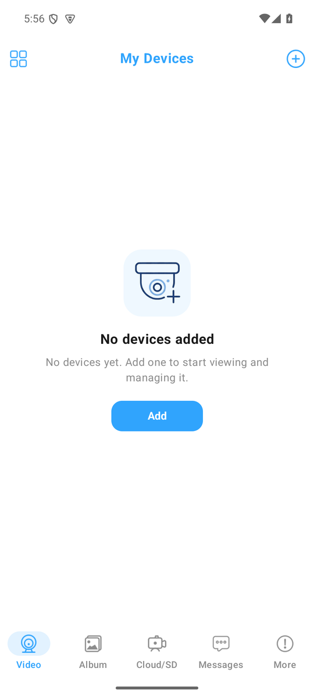
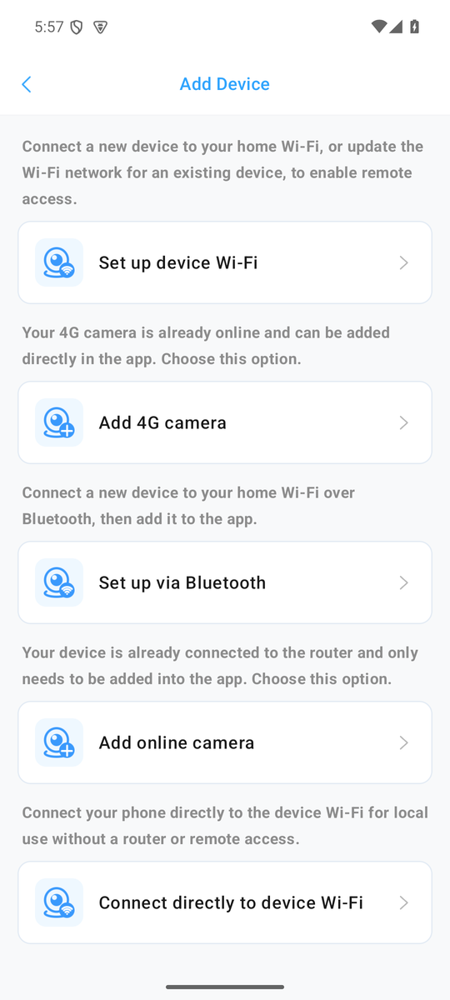

# LookCam Service

Self-contained PPPP/PPCS camera service with a web UI, RTSP bridge, SD-card access and remote recording for LookCam cameras. Python 3.9+ standard library only. No vendor SDK is required.

## Features

- Live view over WebSocket: WebCodecs player with MSE/fMP4 fallback.
- Multiple cameras, one PPPP session per camera, reconnect with backoff.
- Camera settings, actions, reboot, password change and time sync.
- SD card: file list, download queue, resume, HTTP Range playback and seek without a full download.
- RTSP 1.0 over TCP and UDP with Digest authentication, H.264 RTP and RTCP.
- Optional fMP4 recording and snapshots via ffmpeg or OpenCV.
- Wi-Fi provisioning wizard and DID-based discovery.
- English/Russian web UI.
- systemd, Docker and Windows Task Scheduler deployment files.

## Screenshots

Android app (APK):

| My Devices | Add Device |
|---|---|
|  |  |

Web UI with a synthetic demo camera stream:


The video frame is a generated test pattern. No real camera footage or identifiers are used.

## Requirements

- Python 3.9 or newer.
- UDP port 32108 for PPPP.
- TCP port 8080 for HTTP/WebSocket.
- TCP port 8554 for RTSP, if used.
- `ffmpeg` or OpenCV only for server-side snapshots.

## Run

From the repository root:

```bash
python -m service
```

Alternative:

```bash
python run.py
```

Open `http://<host>:8080/`. On the first run the service asks to create the administrator password. Setup is allowed only from localhost. Add a camera by DID and camera password, or use the LAN discovery button.

## Configuration

The default config is `config/lookcam_service.json`. The service creates it on first start. Use `config/lookcam_service.example.json` as a template. A different file can be passed with `--config path.json`.

```json
{
  "http": {"bind": "0.0.0.0", "port": 8080},
  "rtsp": {
    "enable": true,
    "bind": "127.0.0.1",
    "port": 8554,
    "user": "viewer",
    "password_hash": "",
    "realm": "LookCam",
    "low_latency": true
  },
  "admin": {
    "password_hash": "",
    "auth": true,
    "cookie_secret": "",
    "session_hours": 72,
    "login_attempts": 8,
    "login_window_s": 300
  },
  "cache_dir": "../lookcam_data",
  "cache_limit_mb": 4096,
  "idle_ttl_s": 30,
  "log_level": "INFO",
  "debug_raw": false,
  "cameras": [
    {
      "id": "camera1",
      "name": "Example Camera",
      "did": "G000000ABCDE",
      "password": "change-me",
      "host_hint": "192.0.2.10",
      "quality": "HD",
      "keep_alive": false,
      "enabled": true
    }
  ]
}
```

Main options:

- `http.bind` and `http.port`: web UI and API listener.
- `rtsp.bind`: RTSP listener. Default is localhost. A non-loopback bind requires an RTSP password.
- `rtsp.low_latency`: do not replay the cached GOP. Default `true`; use `false` for instant cached start.
- `admin.auth`: enable the web login. First-run setup is localhost only.
- `cache_dir`: cache root. A relative path is resolved from the config directory.
- `cache_limit_mb`: SD cache limit.
- `idle_ttl_s`: seconds to keep a camera session after the last viewer.
- `cameras[].did`: virtual DID in the format used by the camera app.
- `cameras[].quality`: `HD`, `SD` or `VGA`.
- `cameras[].keep_alive`: keep the camera session open without viewers.
- `cameras[].enabled`: enable or disable the camera.

Do not commit `config/lookcam_service.json`, `lookcam_data/` or log files. They contain camera passwords and runtime data and are excluded by `.gitignore`.

## Tests

```bash
python tests/test_service.py
python tools/check_service_js.py
node tools/check_i18n.mjs
```

The service test currently has 74 checks and uses only loopback emulators.
